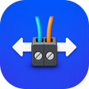
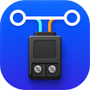

# ESP-Brookesia Factory Firmware

[](https://github.com/espressif/esp-idf/releases)
[](https://www.espressif.com/en/products/socs/esp32-p4)
[](https://lvgl.io/)

English | [简体中文](README_ZH.md)

This directory contains the ESP-Brookesia firmware source for the
**Waveshare ESP32-P4-WIFI6-Touch-LCD-7B**. It drives the on-board 7-inch MIPI-DSI
touch panel, the ES8311 and ES7210 audio codecs, the OV5647 camera, the SD card
and ESP32-C6 hosted Wi-Fi, and adds RS485 and CAN/TWAI terminal applications.

## Platform configuration

| Item | Configuration |
| --- | --- |
| Host MCU | ESP32-P4 Rev3.x, 32 MiB flash, hex-mode PSRAM at 250 MHz |
| Display / touch | 7-inch EK79007 1024 x 600 MIPI-DSI panel, GT911 capacitive touch |
| Framework | ESP-IDF v5.5; `main/idf_component.yml` requires `>=5.5,<6.0` |
| UI | LVGL 9.5.0 with the local ESP-Brookesia core 0.6.0-beta2 |
| Board support | `espressif/esp_board_manager` ^0.7.5, `waveshare/waveshare_boards` ^0.2.0 and the local [`board`](components/board/) component |
| LVGL adapter | `espressif/esp_lvgl_adapter` ^0.7.3~1 |
| Wireless | ESP32-C6 over SDIO using ESP-Hosted 1.4.7 / `esp_wifi_remote` 0.14.5 |
| Voice assistant | `espressif/esp_xiaozhi` 0.1.3~1, ESP-SR 2.4.7 and xiaozhi-fonts 1.6.0 |
| Media | `espressif/esp_extractor` 1.0.7, `esp_new_jpeg` 1.0.2, `esp_video` ^2.3.0 |

The board definition `esp32_p4_wifi6_touch_lcd_7b` describes the display, touch,
audio, camera, SD card and backlight. The local `board` component wraps those
devices for the applications and also owns RS485, CAN and Wi-Fi access. See
[ESP32-P4 revision configuration](../../docs/ESP32P4_REVISION_CONFIG.md) for
silicon profiles, and [Firmware and CI packages](../../docs/firmware.md) for how
firmware images differ from CI artifacts.

## Applications

<table>
  <tr>
    <td align="center"><br><b>DrawPanel</b></td>
    <td align="center"><br><b>Squareline</b></td>
    <td align="center"><br><b>Calculator</b></td>
    <td align="center"><br><b>SpecAnalyzer</b></td>
    <td align="center"><br><b>MusicPlayer</b></td>
    <td align="center"><br><b>Camera</b></td>
  </tr>
  <tr>
    <td align="center"><br><b>VideoPlayer</b></td>
    <td align="center"><br><b>RS485</b></td>
    <td align="center"><br><b>CAN</b></td>
    <td align="center"><br><b>Settings</b></td>
    <td align="center"><br><b>AIChats</b></td>
  </tr>
</table>

| Application | Function | Runtime dependency |
| --- | --- | --- |
| DrawPanel | Drawing in a fixed canvas area without dragging the entire app at the edge | Display and touch |
| Squareline | Registry-installed Squareline Studio UI demo and application template | Display and touch |
| Calculator | Touch-friendly Brookesia calculator | Display and touch |
| SpecAnalyzer | Two-channel FFT spectrum from the on-board microphones | ES7210 input |
| MusicPlayer | Plays the MP3 files in `/spiffs/music` with a spectrum visualizer | SPIFFS `storage`, ES8311 output |
| Camera | OV5647 MIPI CSI preview, scaled by the PPA to fill the panel | OV5647, `esp_video` |
| VideoPlayer | Full-screen SD-card AVI/MJPEG playback with PCM audio | SD card, JPEG/PPA, ES8311 output |
| RS485 | UART1 RS485 terminal; sends a greeting automatically by default | On-board automatic-direction transceiver |
| CAN | 500 kbit/s TWAI terminal; reports bus state and requests recovery after BUS_OFF | On-board TJA1051 |
| Settings | WLAN scan/connect, sound, display brightness, SNTP time and device information | ESP32-C6 hosted Wi-Fi |
| AIChats | Network check, Xiaozhi activation, WakeNet wake word, AEC/VAD, Opus uplink/downlink, server transcript and TTS | Wi-Fi, `model`/`storage` images, ES8311, ES7210 |

## Build

### Requirements

Use ESP-IDF v5.5 with the `esp32p4` toolchain. Network access to the ESP
Component Registry is required, and the `idf.py bmgr` command comes from
`esp-bmgr-assist`. Use a data-capable USB cable for flashing.

All commands below run from this directory. Starting from the repository root:

```sh
cd firmware/brookesia
python -m pip install esp-bmgr-assist==0.8.3
idf.py --version
idf.py set-target esp32p4
idf.py bmgr -b esp32_p4_wifi6_touch_lcd_7b
idf.py build
```

`sdkconfig.defaults` targets ESP32-P4 Rev3.x silicon. `build/`,
`managed_components/`, `dependencies.lock` and `sdkconfig` are generated locally.

Board Manager settings have priority over `sdkconfig.defaults` when `sdkconfig`
is generated. The board definition selects the sensor's default IPA file, which
has no AWB module, so select `components/Camera/config/ov5647_ipa.json` as the
custom OV5647 IPA file in `idf.py menuconfig` before building. A new `sdkconfig`
needs this step again.

### First full flash and partition changes

The first installation must write the bootloader, partition table, application,
ESP-SR model and SPIFFS resources:

```sh
idf.py -p PORT flash monitor
```

Erase the flash before a full flash when changing partition offsets or sizes,
upgrading from an older partition layout, or investigating stale model or
filesystem images:

```sh
idf.py -p PORT erase-flash flash monitor
```

When the partition layout, voice model and `spiffs/` resources are unchanged,
you can flash only the application:

```sh
idf.py -p PORT app-flash monitor
```

`app-flash` does not update `srmodels.bin`, `storage.bin` or the partition
table. Run a full `flash` after changing `partitions.csv`, WakeNet/model Kconfig,
xiaozhi-fonts, bundled music or prompt audio.

### Flash partitions

The layout is defined in `partitions.csv`; the partition table is at `0x9000`:

| Name | Type | Offset | Size | Purpose |
| --- | --- | --- | --- | --- |
| `nvsfactory` | data / nvs | `0xA000` | 200 KiB | Factory NVS data |
| `nvs` | data / nvs | `0x3C000` | 840 KiB | Wi-Fi, app settings and Xiaozhi state |
| `otadata` | data / ota | `0x10E000` | 8 KiB | OTA data (reserved) |
| `phy_init` | data / phy | `0x110000` | 4 KiB | PHY calibration data |
| `model` | data / spiffs | `0x111000` | 956 KiB | ESP-SR speech models (`srmodels.bin`) |
| `factory` | app / factory | `0x200000` | 8 MiB | Application |
| `storage` | data / spiffs | `0xA00000` | 6 MiB | Music, Xiaozhi prompts and font (`storage.bin`) |

### Erase NVS only

To clear Wi-Fi, app settings and Xiaozhi state without reflashing the firmware,
run this from an activated ESP-IDF environment. In PowerShell, use
`$env:IDF_PATH` instead of `$IDF_PATH`:

```sh
python $IDF_PATH/components/partition_table/parttool.py --port PORT --partition-table-offset 0x9000 erase_partition --partition-name=nvs
```

Reset the board and configure WLAN again in Settings. `idf.py flash` does not
write the `nvs` partition, so it keeps this data.

## AIChats / Xiaozhi

AIChats uses `esp_xiaozhi` for the protocol. This project provides the UI,
activation, audio and lifecycle integration.

First use:

1. Configure WLAN in Settings.
2. Open AIChats. If the device is not associated with an account, it displays
   and announces an activation code.
3. Add the device in the [Xiaozhi control panel](https://xiaozhi.me) and enter
   the activation code.
4. When the page reaches standby, say the wake phrase. The default is
   "Ni Hao Xiao Zhi."

If the log reports `Speech model partition 'model' is missing` or
`Speech model image is empty or unreadable`, rebuild and perform a full flash to
write both the partition table and `srmodels.bin`.

The local UI language and transport can be selected in this menu.
`sdkconfig.defaults` selects English and Auto:

```text
idf.py menuconfig
  Xiaozhi Application
    Local UI language            English / Simplified Chinese
    Preferred Xiaozhi transport  WebSocket / Auto / MQTT+UDP
```

The language option controls firmware-owned text only. It does not translate
conversation text, TTS or activation messages returned by the server. Local
strings are in `components/XiaozhiApp/XiaozhiLocalization.*`.

The board uses the ES8311 for audio output and the ES7210 for input. AIChats
feeds MIC1, MIC2 and the echo reference to the AFE at 16 kHz in the `MMR` layout
with AEC enabled, then encodes 16 kHz mono Opus for uplink. Server audio is
decoded at 24 kHz for output.

## RS485 and CAN

| Application | Pins and configuration | Board behavior |
| --- | --- | --- |
| RS485 | UART1: GPIO27 TX, GPIO26 RX, 115200 8N1 | The automatic-direction transceiver needs no RTS/DE GPIO. Automatic greeting transmission is enabled by default. |
| CAN | GPIO22 TX, GPIO21 RX; 500 kbit/s normal mode | Uses the on-board TJA1051. Automatic transmission is disabled by default. |

See the [HardwareApps notes](components/HardwareApps/README.md) for power-domain
details and validation limits. A real CAN bus needs peer acknowledgement and
appropriate termination.

## Camera and media

Camera runs the OV5647 in its 800 x 640 binned mode. The PPA cover-fills the
1024 x 600 panel, cropping the source so that the scale factor lands on the PPA's
1/16 steps.

VideoPlayer scans only `/sdcard/avi`; the `.avi` extension is case-insensitive.
AVI files in the SD card root and other containers such as MP4 or MOV are not
listed. The player demuxes AVI with `esp_extractor`, decodes MJPEG with the
hardware JPEG decoder (falling back to `esp_new_jpeg` for frames the hardware
cannot decode, such as progressive JPEG), and writes frames through the PPA
directly into the LCD frame buffer:

- Only MJPEG video is played. Only PCM audio is played; other audio formats
  are skipped and the video plays silently.
- Frames follow the UI rotation and are center-cropped to fill the screen; a
  16:9 video on the 1024 x 600 panel loses about 2% on each side.

Convert other videos with ffmpeg, for example:

```sh
ffmpeg -i input.mov -c:v mjpeg -q:v 5 -pix_fmt yuvj420p -r 24 -c:a pcm_s16le -ar 44100 -ac 2 output.avi
```

Raise `-q:v` (lower quality) or scale the video down if playback drops frames.

MusicPlayer plays the MP3 files in `/spiffs/music`. After changing tracks,
regenerate and flash `storage.bin`; `app-flash` alone does not update it.

## Development notes

- Apps register themselves with `ESP_UTILS_REGISTER_PLUGIN_WITH_CONSTRUCTOR`.
  `BOOT_APP_GROUPS` in `main/main.cpp` sets only the home-screen order and the
  boot stage shown while each group installs; registered apps not listed there
  are installed after the last group.
- New apps derive from `esp_brookesia::systems::phone::App` and implement
  `run()` and `back()`. Override other lifecycle functions according to
  resource ownership. Each component declares its own dependencies in its
  `idf_component.yml`; `main` keeps only the ones it uses directly.
- The MCP tool entry point is `registerXiaozhiDeveloperTools()` in
  `components/XiaozhiApp/XiaozhiDeveloperTools.cpp`. Register only implemented
  tools that return real results; run long operations in an application task.
- Access LVGL objects on the LVGL thread or while holding the display lock
  briefly. On app shutdown, release its timers, tasks, queues, codec sessions,
  SD handles and LVGL objects.
- During playback, VideoPlayer enables the adapter's Dummy Draw and pauses LVGL.
  On exit, it stops playback and resumes LVGL rendering.

## Notes

- Use the LVGL lock only for UI operations. Run networking, SD scans, audio
  initialization, NVS access and model loading outside the lock.
- Model, font, prompt, music and partition changes require a full `flash`.
- Audio apps share one physical bus. Stop or hand off the codec session when
  switching between apps.
- The host component must remain compatible with the coprocessor firmware on
  the ESP32-C6. `esp_wifi_remote` and `esp_hosted` are pinned in
  `main/idf_component.yml`; confirm the coprocessor firmware before upgrading.

`EXAMPLE_SHOW_MEM_INFO` in `main/main.cpp` is currently `true`, so periodic
SRAM/PSRAM statistics are enabled. The detailed log output is controlled
separately by `EXAMPLE_SHOW_MEM_INFO_LOG`.

When reporting an issue, include the board and silicon revision, ESP-IDF version,
complete reproduction steps and the first actual error in the logs.

The local Brookesia core uses the
[Apache-2.0 license](components/brookesia_core/license.txt), which applies only
to that component. Code in `components/XiaozhiApp/third_party/xiaozhi_esp32/` is
covered by the MIT license in its directory.
