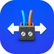
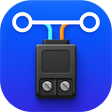

# ESP-Brookesia 出厂固件

[](https://github.com/espressif/esp-idf/releases)
[](https://www.espressif.com/en/products/socs/esp32-p4)
[](https://lvgl.io/)

[English](README.md) | 简体中文

本目录是 **Waveshare ESP32-P4-WIFI6-Touch-LCD-7B** 的 ESP-Brookesia 固件源码，
支持板载 7 英寸 MIPI-DSI 触摸屏、ES8311 和 ES7210 音频编解码器、OV5647 摄像头、
SD 卡和 ESP32-C6 Hosted Wi-Fi，并提供 RS485 和 CAN/TWAI 终端应用。

## 平台配置

| 项目 | 配置 |
| --- | --- |
| 主控 | ESP32-P4 Rev3.x，32 MiB Flash，Hex 模式 PSRAM（250 MHz） |
| 显示 / 触摸 | 7 英寸 EK79007 1024 x 600 MIPI-DSI 屏，GT911 电容触摸 |
| 框架 | ESP-IDF v5.5；`main/idf_component.yml` 要求 `>=5.5,<6.0` |
| UI | LVGL 9.5.0，本地 ESP-Brookesia core 0.6.0-beta2 |
| 板级支持 | `espressif/esp_board_manager` ^0.7.5、`waveshare/waveshare_boards` ^0.2.0 和本地 [`board`](components/board/) 组件 |
| LVGL 适配 | `espressif/esp_lvgl_adapter` ^0.7.3~1 |
| 无线 | ESP32-C6 经 SDIO 连接，使用 ESP-Hosted 1.4.7 / `esp_wifi_remote` 0.14.5 |
| 语音助手 | `espressif/esp_xiaozhi` 0.1.3~1、ESP-SR 2.4.7、xiaozhi-fonts 1.6.0 |
| 多媒体 | `espressif/esp_extractor` 1.0.7、`esp_new_jpeg` 1.0.2、`esp_video` ^2.3.0 |

板级定义 `esp32_p4_wifi6_touch_lcd_7b` 描述显示、触摸、音频、摄像头、SD 卡和背光。
本地 `board` 组件为应用封装这些设备，并负责 RS485、CAN 和 Wi-Fi 访问。芯片版本配置见
[ESP32-P4 版本配置](../../docs/ESP32P4_REVISION_CONFIG_ZH.md)，固件镜像与 CI 构件的区别见
[固件与 CI 包](../../docs/firmware_ZH.md)。

## 应用

<table>
  <tr>
    <td align="center"><br><b>DrawPanel</b></td>
    <td align="center"><br><b>Squareline</b></td>
    <td align="center"><br><b>Calculator</b></td>
    <td align="center"><br><b>SpecAnalyzer</b></td>
    <td align="center"><br><b>MusicPlayer</b></td>
    <td align="center"><br><b>Camera</b></td>
  </tr>
  <tr>
    <td align="center"><br><b>VideoPlayer</b></td>
    <td align="center"><br><b>RS485</b></td>
    <td align="center"><br><b>CAN</b></td>
    <td align="center"><br><b>Settings</b></td>
    <td align="center"><br><b>AIChats</b></td>
  </tr>
</table>

| 应用 | 功能 | 运行依赖 |
| --- | --- | --- |
| DrawPanel | 固定画布区域绘图，在边缘绘画不会拖动整个应用 | 显示与触摸 |
| Squareline | 从组件仓库安装的 Squareline Studio UI 演示与应用模板 | 显示与触摸 |
| Calculator | 适合触摸操作的 Brookesia 计算器 | 显示与触摸 |
| SpecAnalyzer | 板载麦克风的双通道 FFT 频谱 | ES7210 输入 |
| MusicPlayer | 播放 `/spiffs/music` 中的 MP3，带频谱可视化 | SPIFFS `storage`，ES8311 输出 |
| Camera | OV5647 MIPI CSI 预览，由 PPA 缩放铺满屏幕 | OV5647，`esp_video` |
| VideoPlayer | 全屏播放 SD 卡中的 AVI/MJPEG 视频，支持 PCM 音频 | SD 卡，JPEG/PPA，ES8311 输出 |
| RS485 | UART1 RS485 终端，默认自动发送问候语 | 板载自动方向收发器 |
| CAN | 500 kbit/s TWAI 终端，显示总线状态并在 BUS_OFF 后请求恢复 | 板载 TJA1051 |
| Settings | WLAN 扫描/连接、声音、屏幕亮度、SNTP 时间和设备信息 | ESP32-C6 Hosted Wi-Fi |
| AIChats | 网络检查、小智激活、WakeNet 唤醒词、AEC/VAD、Opus 上下行、服务端文本和 TTS | Wi-Fi，`model`/`storage` 镜像，ES8311，ES7210 |

## 编译

### 环境要求

使用 ESP-IDF v5.5 和 `esp32p4` 工具链，需要能访问 ESP 组件仓库。`idf.py bmgr`
命令由 `esp-bmgr-assist` 提供。烧录时请使用支持数据传输的 USB 线。

以下命令都在本目录下运行。从仓库根目录开始：

```sh
cd firmware/brookesia
python -m pip install esp-bmgr-assist==0.8.3
idf.py --version
idf.py set-target esp32p4
idf.py bmgr -b esp32_p4_wifi6_touch_lcd_7b
idf.py build
```

`sdkconfig.defaults` 面向 ESP32-P4 Rev3.x 芯片。`build/`、`managed_components/`、
`dependencies.lock` 和 `sdkconfig` 都在本地生成。

生成 `sdkconfig` 时，Board Manager 的配置优先级高于 `sdkconfig.defaults`。板级定义选择的是传感器
默认 IPA 文件，其中没有 AWB 模块，所以构建前请在 `idf.py menuconfig` 中将 OV5647 的自定义 IPA 文件
设为 `components/Camera/config/ov5647_ipa.json`。重新生成 `sdkconfig` 后需要再次设置。

### 首次完整烧录与分区变更

首次安装必须写入 bootloader、分区表、应用、ESP-SR 模型和 SPIFFS 资源：

```sh
idf.py -p PORT flash monitor
```

修改分区偏移或大小、从旧分区布局升级、或排查模型/文件系统镜像残留时，
先擦除 Flash 再完整烧录：

```sh
idf.py -p PORT erase-flash flash monitor
```

分区布局、语音模型和 `spiffs/` 资源都没有变化时，可以只烧录应用：

```sh
idf.py -p PORT app-flash monitor
```

`app-flash` 不会更新 `srmodels.bin`、`storage.bin` 和分区表。修改
`partitions.csv`、WakeNet/模型 Kconfig、xiaozhi-fonts、内置音乐或提示音后，
需要执行完整 `flash`。

### Flash 分区

分区布局定义在 `partitions.csv`，分区表位于 `0x9000`：

| 名称 | 类型 | 偏移 | 大小 | 用途 |
| --- | --- | --- | --- | --- |
| `nvsfactory` | data / nvs | `0xA000` | 200 KiB | 出厂 NVS 数据 |
| `nvs` | data / nvs | `0x3C000` | 840 KiB | Wi-Fi、应用设置和小智状态 |
| `otadata` | data / ota | `0x10E000` | 8 KiB | OTA 数据（预留） |
| `phy_init` | data / phy | `0x110000` | 4 KiB | PHY 校准数据 |
| `model` | data / spiffs | `0x111000` | 956 KiB | ESP-SR 语音模型（`srmodels.bin`） |
| `factory` | app / factory | `0x200000` | 8 MiB | 应用程序 |
| `storage` | data / spiffs | `0xA00000` | 6 MiB | 音乐、小智提示音和字体（`storage.bin`） |

### 单独擦除 NVS

如需清除 Wi-Fi、应用设置和小智状态而不重新烧录固件，请在已激活的 ESP-IDF 环境中运行
以下命令。PowerShell 中请将 `$IDF_PATH` 换成 `$env:IDF_PATH`：

```sh
python $IDF_PATH/components/partition_table/parttool.py --port PORT --partition-table-offset 0x9000 erase_partition --partition-name=nvs
```

擦除后复位开发板，并在 Settings 中重新配置 WLAN。`idf.py flash` 不会写入 `nvs`
分区，因此不会清除这些数据。

## AIChats / 小智

AIChats 使用 `esp_xiaozhi` 处理协议，本工程负责 UI、激活、音频和生命周期集成。

首次使用：

1. 在 Settings 中配置 WLAN。
2. 打开 AIChats。如果设备尚未绑定账号，会显示并播报激活码。
3. 在[小智控制台](https://xiaozhi.me)添加设备并输入激活码。
4. 页面进入待机后说出唤醒词，默认是“你好小智”。

如果日志出现 `Speech model partition 'model' is missing` 或
`Speech model image is empty or unreadable`，请重新编译并完整烧录，以写入分区表和
`srmodels.bin`。

本地 UI 语言和传输方式可在以下菜单中选择，`sdkconfig.defaults` 默认选择 English 和 Auto：

```text
idf.py menuconfig
  Xiaozhi Application
    Local UI language            English / Simplified Chinese
    Preferred Xiaozhi transport  WebSocket / Auto / MQTT+UDP
```

语言选项只影响固件自带的文本，不会翻译服务端返回的对话文本、TTS 或激活消息。
本地字符串位于 `components/XiaozhiApp/XiaozhiLocalization.*`。

开发板使用 ES8311 输出音频，使用 ES7210 采集音频。AIChats 将 MIC1、MIC2 和回声参考
以 `MMR` 布局、16 kHz 送入 AFE 并启用 AEC，再编码为 16 kHz 单声道 Opus 上行。
服务端音频按 24 kHz 解码后输出。

## RS485 和 CAN

| 应用 | 引脚与配置 | 板级行为 |
| --- | --- | --- |
| RS485 | UART1：GPIO27 TX，GPIO26 RX，115200 8N1 | 自动方向收发器不需要 RTS/DE GPIO，默认启用自动发送问候语。 |
| CAN | GPIO22 TX，GPIO21 RX；500 kbit/s 正常模式 | 使用板载 TJA1051，默认关闭自动发送。 |

电源域和验证范围见 [HardwareApps 说明](components/HardwareApps/README_ZH.md)。
实际 CAN 总线需要对端应答和合适的终端电阻。

## 摄像头与多媒体

Camera 使用 OV5647 的 800 x 640 binning 模式。PPA 将画面裁剪后铺满 1024 x 600 屏幕，
裁剪尺寸按 PPA 1/16 步进的缩放系数计算。

VideoPlayer 只扫描 `/sdcard/avi`，`.avi` 扩展名不区分大小写。SD 卡根目录下的
AVI 以及 MP4、MOV 等其他容器不会被列出。播放器使用 `esp_extractor` 解封装 AVI，
用硬件 JPEG 解码器解码 MJPEG（硬件无法解码的帧，例如渐进式 JPEG，回退到
`esp_new_jpeg`），再经 PPA 直接写入 LCD 帧缓冲：

- 视频只支持 MJPEG，音频只支持 PCM；其他音频格式会被跳过，视频静音播放。
- 画面跟随 UI 旋转方向，并居中裁剪以铺满屏幕；16:9 视频在 1024 x 600 屏幕上左右各裁掉约 2%。

其他视频可用 ffmpeg 转换，例如：

```sh
ffmpeg -i input.mov -c:v mjpeg -q:v 5 -pix_fmt yuvj420p -r 24 -c:a pcm_s16le -ar 44100 -ac 2 output.avi
```

如果播放丢帧，可以调大 `-q:v`（降低画质）或缩小视频分辨率。

MusicPlayer 播放 `/spiffs/music` 中的 MP3。更换曲目后需要重新生成并烧录
`storage.bin`，仅 `app-flash` 不会更新它。

## 开发说明

- 应用通过 `ESP_UTILS_REGISTER_PLUGIN_WITH_CONSTRUCTOR` 自行注册。
  `main/main.cpp` 中的 `BOOT_APP_GROUPS` 只决定主屏顺序以及各组安装时显示的启动阶段；
  已注册但未列出的应用会在最后一组之后安装。
- 新应用继承 `esp_brookesia::systems::phone::App` 并实现 `run()` 和 `back()`，
  其他生命周期函数按资源归属按需重写。每个组件在自己的 `idf_component.yml`
  中声明依赖，`main` 只保留直接使用的依赖。
- MCP 工具入口是 `components/XiaozhiApp/XiaozhiDeveloperTools.cpp` 中的
  `registerXiaozhiDeveloperTools()`。只注册已实现且返回真实结果的工具，
  耗时操作放在应用任务中执行。
- 在 LVGL 线程中访问 LVGL 对象，或短暂持有显示锁。应用关闭时释放其定时器、
  任务、队列、编解码器会话、SD 句柄和 LVGL 对象。
- 播放期间 VideoPlayer 会启用适配层的 Dummy Draw 并暂停 LVGL，退出时停止播放并恢复
  LVGL 渲染。

## 注意事项

- LVGL 锁只用于 UI 操作。网络、SD 扫描、音频初始化、NVS 访问和模型加载都应在锁外执行。
- 修改模型、字体、提示音、音乐或分区后需要完整 `flash`。
- 音频应用共用同一条物理总线，切换应用时要停止或交接编解码器会话。
- Host 组件需要与 ESP32-C6 上的协处理器固件保持兼容。`esp_wifi_remote` 和 `esp_hosted`
  的版本固定在 `main/idf_component.yml` 中，升级前请先确认协处理器固件。

`main/main.cpp` 中的 `EXAMPLE_SHOW_MEM_INFO` 当前为 `true`，会周期性统计 SRAM/PSRAM；
详细日志输出由 `EXAMPLE_SHOW_MEM_INFO_LOG` 单独控制。

反馈问题时，请提供开发板和芯片版本、ESP-IDF 版本、完整复现步骤和日志中第一个实际错误。

本地 Brookesia core 使用 [Apache-2.0 许可证](components/brookesia_core/license.txt)，
仅适用于该组件。`components/XiaozhiApp/third_party/xiaozhi_esp32/` 中的代码适用该目录下的
MIT 许可证。
